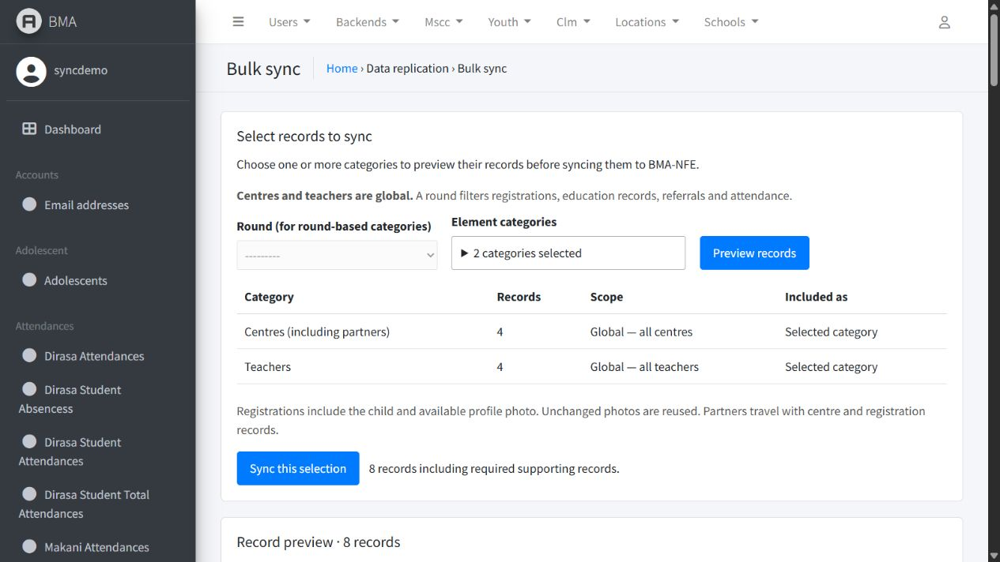
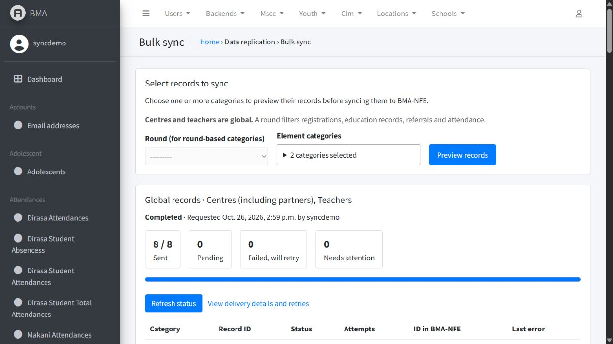
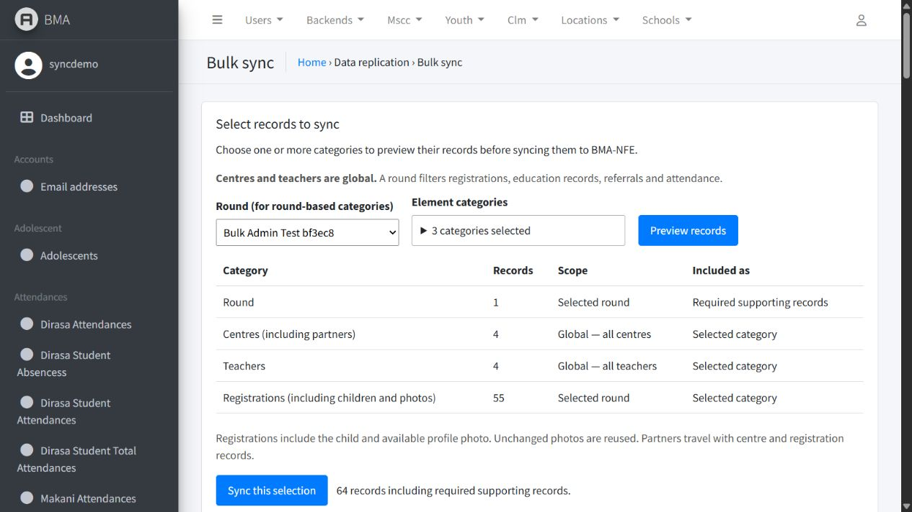

# Bulk sync

In Compiler admin, open **Data replication → Bulk sync**. Open **Element
categories**, tick one or more categories, then click **Preview records**.
Centres and teachers are global: neither needs a round selection. Choose an
MSCC round when selecting registrations, education records, referrals,
attendance or the round itself.

The dropdown supports multiple selections without holding Ctrl. The list is
read-only and paginated. Its **Scope** column distinguishes all global master
records, round-specific records and referenced centres needed as supporting
records. Choose **All categories** to include all centres and teachers plus
the round-specific records from the selected round.
It clears individual selections; choosing an individual category clears All.
Required supporting records are combined and queued once per request, even
when several selected categories reference the same registration or centre.

Click **Sync this selection**, then **Refresh status** to see pending, sent,
retrying and abandoned deliveries. **View delivery details and retries** opens
the existing Sync events page filtered to that request. Existing retry actions
work there. A Sent result confirms the receiver accepted the event; a failed
HTTP request is displayed as failed even when the Celery task itself completed.

Registrations include their child and available profile photo through the
existing unified endpoint. Unchanged photos use the existing verified-reuse
mechanism. Partners are embedded in centre/registration events. The page does
not change Compiler storage or add an image endpoint.

## Record scope

- Registrations belong to the selected MSCC round. Education services,
  assessments, grading and referrals are selected through their registration.
- Attendance uses its stored MSCC round ID and carries its existing child rows.
- Teachers are selected globally, including teachers assigned to another round
  and teachers without any round. The existing school-to-centre mapping still
  determines their destination centre. Existing optional round metadata is
  preserved; the selected registration round is never assigned to a teacher.
- Selecting Centres includes all centres, including those unused by the
  selected round. If Centres is not selected, only the centres required by the
  other selected records are included as supporting records.
- Categories include only their required parents; selecting assessments does not
  queue unrelated teachers or every registration in the round.
- Missing teacher mappings, attendance pointing at another round's registration,
  and education services with conflicting rounds must be corrected before starting.

## Queue and permissions

A POST saves a durable request and wakes the existing outbox sweep. The worker
queues events in bounded database batches inside one transaction and then uses
the existing dispatcher, dependency order, connection pools, upload limit and
retry policy. No HTTP upload runs in the admin request. The periodic sweep also
prepares waiting requests if the immediate broker notification was missed.
Queue preparation is locked and idempotent; submitting the same form twice
does not create duplicate runs, even if the category order changes. Previewing
a page never queues anything. The saved request retains its complete category
selection, and pagination preserves every selection.

The worker selects current global records and, when applicable, current round
membership when preparing a request. Global-only requests save no round. The
saved run's delivery table records the exact outbox events it created. Records
added later can be included by starting a new request. Ordinary edits continue
to use automatic change capture.

Superusers have access automatically. Other staff need `datasync.view_bulksyncrun`
and source view permissions to preview. Starting requires
`datasync.add_bulksyncrun`. They also need permission to view all included parent
models. Staff see their own request history; superusers see all requests.
An operator syncing only global categories does not need round permissions;
round names are hidden when the operator cannot view rounds.
Grant `datasync.view_syncevent` and `datasync.change_syncevent` as appropriate
for inspecting delivery details and using its existing retry action.

## Deployment

Deploy Compiler, apply `python manage.py migrate`, and restart the web app,
Celery worker and beat. Migration `datasync.0005_bulk_round_sync` adds request
history and an optional run reference on outbox events.
`datasync.0006_bulk_sync_categories` stores multiple selections. Earlier requests
retain their original single category or All categories selection.
`datasync.0007_bulk_sync_global_records` makes the request's round optional
and renames the sidebar entry to Bulk sync. No NFE migration is
required for this screen. The worker must consume the existing `datasync`
queue and the periodic outbox sweep must remain scheduled.

`DATASYNC_ENABLED`, `DATASYNC_TARGET_URL` and `DATASYNC_TARGET_TOKEN` must be
configured. This feature does not resolve a destination HTTP 403; the configured
NFE receiver and its service-account access still need to be correct.

## Local verification — 26 October 2026

- All 97 Compiler sync tests passed, including 47 checks for this feature.
  Coverage includes round boundaries, missing mappings, required parents,
  read-only previews, permissions, CSRF, duplicate form submission, transaction
  rollback, broker recovery and two workers preparing the same request. Global
  scope checks include unassigned centres, teachers from any/no round,
  global-only operators, mixed selections and required-round validation.
- Migration definitions match Django's model state. The actual new migration
  operations were applied successfully to the isolated local demo schema.
- A global-only browser request delivered all four local test centres and
  four teachers with no round selection. This included a newly created centre
  and teacher unused by any round. No round or registration events were queued;
  the teacher without a round remained roundless in NFE.
- A mixed browser request delivered 64 unique events: all four centres, all
  four teachers, 55 registrations from the selected round and that one round.
  A registration belonging to a different round was excluded. No registrations
  were duplicated, the existing photo file was reused and zero image bytes
  were uploaded.
- Browser verification covered the sidebar entry, both dropdowns, the
  read-only list, two preview pages, request history and completed delivery.
  It also verified multiple checkboxes, All/individual selection behavior,
  exact preview counts and submitting the selected categories together.
  The round selector was disabled for global-only selections and required
  again when a round-specific category was added.

These results used local PostgreSQL, local image storage and a real Celery
worker with two local Django projects. They do not verify the deployed Azure
configuration or resolve its previously reported HTTP 403.

