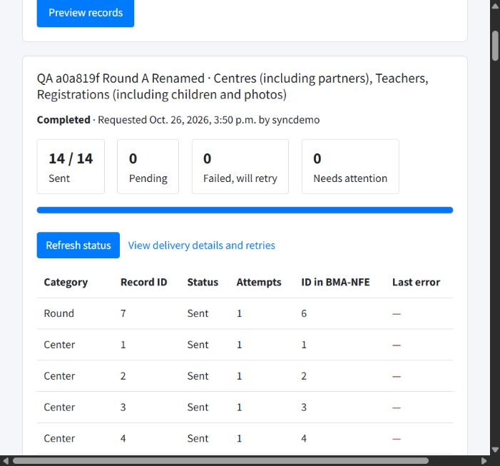
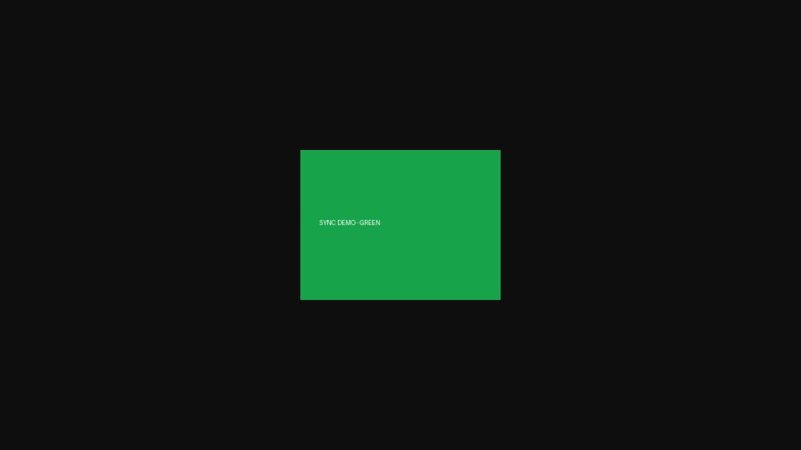

# Manual sync QA - 26 October 2026

Fresh fixture label: `QA a0a819f`. All data is synthetic and local.

## Result

44 distinct form/API/database workflows passed after fixing three failures discovered through ordinary entry forms. The browser was also used to create Round A, preview global categories, select three categories together, start a mixed bulk run and verify its completion. The 14-event browser run finished with 14 sent, zero pending, zero failed and zero photo bytes uploaded.

Regression suites: **106 Compiler tests + 127 BMA-NFE tests = 233 passed**. Nine Compiler regression tests cover the three new fixes.

## Failures found and repaired

| Failure reproduced | Change | Manual verification |
| --- | --- | --- |
| Blank optional assessment grades produced HTTP 500 after inserting a partial assessment. | Validate cleaned form data, normalize blank grades, and save once inside a transaction. | Repaired the same partial ID; a fresh blank-grade assessment produced one complete record and one event; invalid grades created nothing. |
| Saving a school-to-centre link did not notify existing teachers. | Queue affected teachers through the existing outbox. | Changed centre A to B and back to A; the original A assignment was reused. A teacher with no mapping deferred safely and recovered when the mapping was added. |
| Editing only a partner left its NFE name unchanged. | Republish linked centres and registrations, which already carry the embedded partner. | Partner rename arrived automatically and kept the original NFE partner ID. |

Files changed for these fixes: `student_registration/mscc/education_form.py`, `student_registration/datasync/signals.py`, and `student_registration/datasync/tests/test_manual_workflows.py`. No receiver source changes were needed. Compiler Azure storage configuration was left unchanged.

## Test method

Both original clones were run locally: Compiler on port 8000, BMA-NFE on port 8001, with isolated PostgreSQL databases, a real Celery worker and a five-second scheduled outbox sweep. Records were submitted through actual rendered admin/application forms with CSRF tokens and normal validation. The repetitive form and failure tests used HTTP requests; the browser workflows are listed above. Database identities, event receipts and downloaded image bytes were checked independently. Test records were not inserted directly into business tables.

The Compiler disposable schema was built from current models; this was not a rehearsal of its entire historical migration chain. The receiver demo uses its actual migration history. Regression tests ran in a separate disposable test database.

## Fresh fixture IDs

| Entity | Compiler ID |
| --- | --- |
| round_a | 7 |
| round_b | 8 |
| partner | 5 |
| center_a | 5 |
| school_a | 5 |
| link_a | 5 |
| center_b | 6 |
| school_b | 6 |
| link_b | 6 |
| teacher | 5 |
| student | 260 |
| child | 314 |
| registration_a | 316 |
| registration_b | 317 |
| education_service | 4 |
| grading | 4 |
| referral | 4 |
| attendance | 4 |
| attendance_child | 58 |
| assessment_a | 4 |
| assessment_b | 5 |
| school_c | 7 |
| teacher_unmapped | 6 |
| link_c | 7 |

The two registrations share one NFE child (local ID 315, BMA ID 314). The same source ID can exist in another entity category; identities are scoped to the resource.

## Passed workflows

1. Browser-created round delivered automatically.
2. New partner, centres, schools and mappings created through validated admin forms.
3. Teacher without a round linked to its mapped centre.
4. Two registrations in different rounds reuse one child and the exact same photo.
5. Education service, grading, referral and attendance saved through validated forms and delivered.
6. Previously partial assessment repaired by editing the same record.
7. Blank optional grades now create one complete assessment and one delivery event.
8. Invalid assessment grade rejected without a partial record.
9. Mapping edits automatically sync teachers; returning to a centre reuses its record.
10. Edit and unchanged resave preserve the same NFE round_a.
11. Edit and unchanged resave preserve the same NFE center_a.
12. Edit and unchanged resave preserve the same NFE registration_a.
13. Edit and unchanged resave preserve the same NFE education_service.
14. Edit and unchanged resave preserve the same NFE grading.
15. Edit and unchanged resave preserve the same NFE referral.
16. Teacher edit updates the same teacher-centre identity.
17. Education assessment edit reaches the same NFE record.
18. Attendance child edit replaces the day contents without duplicate rows.
19. Duplicate round creation rejected by the form without another sync event.
20. Photo replacement across two registrations uploads the image exactly once.
21. Unchanged photo resave keeps the same file and transfers zero photo bytes.
22. Local NFE photo edit restored automatically in one delivery attempt and audited.
23. Missing NFE photo repaired automatically without duplicate child records.
24. NFE storage failure rolls back metadata; the same queued events recover after storage returns.
25. Missing source image preserves the destination until the same events can retry successfully.
26. Receiver outage preserves the save and retries the same event without a duplicate record.
27. Two simultaneous clicks on the same bulk form create one durable run.
28. Overlapping bulk category runs update existing records, exclude the other round, and transfer zero photo bytes.
29. Twenty concurrent replays keep the original overwrite receipt and cannot restore old data.
30. Incorrect photo checksum rejected with no partial metadata or photo change.
31. Non-image upload rejected with no partial metadata or photo change.
32. Oversized photo rejected with no partial metadata or photo change.
33. Missing attachment rejected with no partial metadata or photo change.
34. Missing and invalid API credentials rejected.
35. Stale update cannot roll back child metadata or clear its photo.
36. Lost acknowledgement simulated: resending the newly applied event reuses one record.
37. Teacher without mapping defers safely; adding its mapping automatically recovers to one record.
38. Full local database audit found no duplicate BMA identities; teacher identity includes centre.
39. Local NFE child metadata edit overwritten by the next source event and audited.
40. Explicit source photo removal clears the synced NFE photo reference.
41. Re-upload after photo removal restores the same child without duplicate registrations.
42. Partner name edit updates the original linked partner.
43. Normal mscc/round deletion syncs and a late old upsert cannot resurrect it.
44. Normal mscc/educationservice deletion syncs and a late old upsert cannot resurrect it.

## Photo and retry evidence

- Replacing the photo through the source Student form uploaded exactly **2,269 image bytes once** for two registrations sharing a child.
- Unchanged resaves and overlapping bulk runs uploaded **zero image bytes**.
- A local NFE photo edit was replaced with the source image in one delivery attempt and retained its overwrite audit.
- Missing destination photo files were repaired. Missing source files and unavailable destination storage deferred delivery without committing partial child changes.
- The receiver was stopped and restarted; the same event UUID recovered with an increased attempt count.
- Photo clearing removed the NFE field reference; re-upload restored the same child. This assertion concerns the current reference, not garbage collection of historical file versions.
- Wrong checksum, non-image content, an oversized upload and missing multipart data were rejected without changing the current metadata/photo.

## Duplicate audit and model boundary

The full isolated NFE database was checked for repeated nonempty BMA IDs in rounds, centres, partners, children, registrations, education services, assessments, grading, referrals and attendance days. None were found. Teachers were checked by **BMA ID + centre**; none of those pairs were duplicated.

**A teacher moved to another centre retains one row per centre under the current model.** The A-to-B-to-A test intentionally left two assignments and reused the first one when returning to A. A single global person record with separate centre memberships would require an explicit model/contract change; this test did not silently change that business rule. Teachers without a round synced successfully.

Partners are carried inside linked centre/registration events. A partner with no such linked record has no standalone Compiler event in the current contract.

All 1,407 events currently in the isolated source outbox were Sent at completion; that total includes earlier local test runs. Deliberately invalid receiver requests remain in the receiver audit as expected failures. All temporary outage markers were cleared, test photo backups restored, and both apps were left running.

## Browser evidence

Browser bulk request ID: `cfbda6a5-55f7-4cf0-b743-70f4045f27ca`.

## Deployment boundary

These results verify the local integration. Azure/SIT networking, deployed worker scheduling and the actual ministry VM file-share mount/permissions still require a test in that environment. No Azure deployment or live file-share access was performed, and no code was committed or pushed.

The fixes, regression tests and this report are saved in the original Compiler clone on `claude/compiler-bma-nfe-sync-ike6uq`. BMA-NFE remains on `claude-api-connection`.
